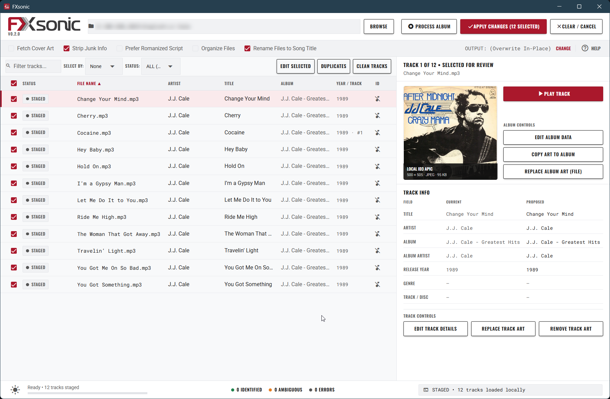
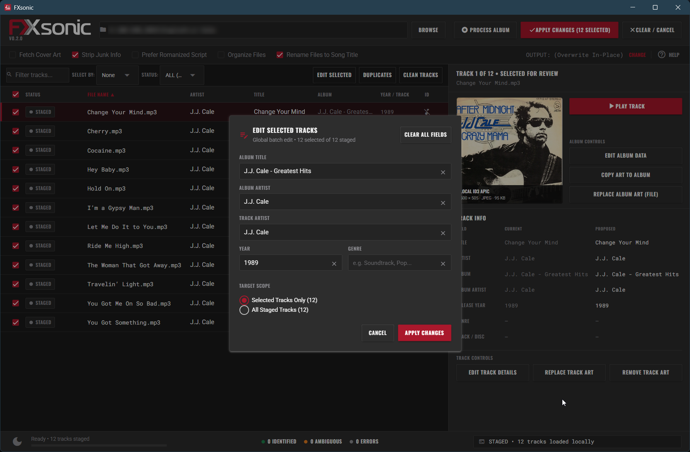
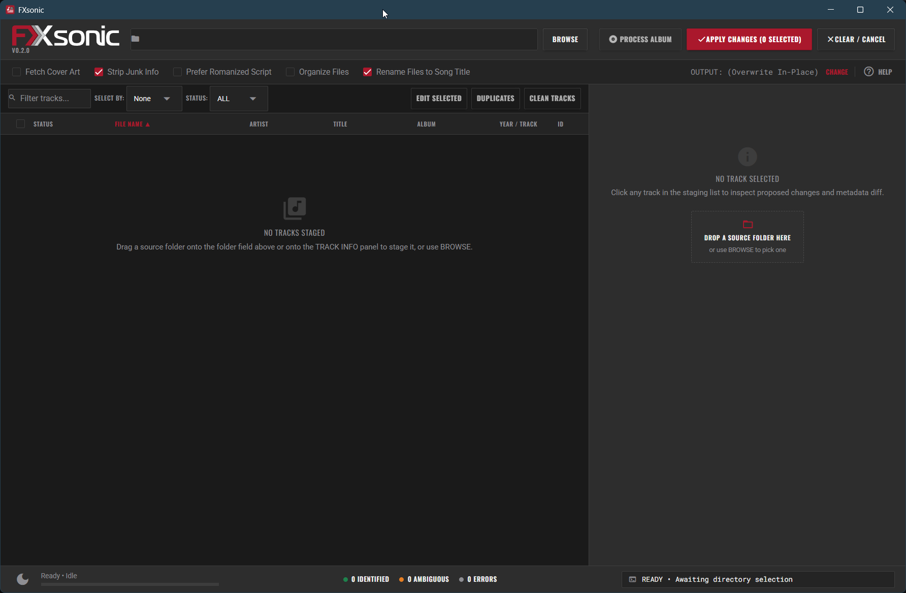

# FXsonic

<p align="center">
  
</p>

FXsonic is a desktop application for audio file tagging and album metadata management. It calculates acoustic fingerprints with Chromaprint to match recordings against the AcoustID and MusicBrainz databases, writes standard ID3v2.4 tags, and embeds album art.

---

## Interface

### Staging table with loaded tracks


### Manual track editor


### Empty drop zone


---

## Features

- Multi-format audio intake: Scans `.mp3`, `.flac`, `.m4a`, `.ogg`, `.opus`, `.wav`, and `.aiff` files.
- Acoustic fingerprinting: Bundled `fpcalc` binary with AcoustID and MusicBrainz matching, including Romanized alias lookups.
- Persistent fingerprint cache: SQLite cache (`cache.db`) stores file modification times and fingerprint hashes, skipping rescans on unmodified files.
- Multi-folder intake: Drag and drop files or folders. Hold `Ctrl` while dropping to append tracks to the table without clearing existing files.
- Staging table sorting and search: Sort by file name, album, artist, title, year, track number, or status. Instant search filters the table in real time.
- Contextual selection: Filter and select tracks by artist, album, folder, or match status.
- Manual track editing: Inspect track metadata, override artist, album, track title, year, and track numbering directly from the table.
- Title cleaning: Clean up noisy titles by stripping bracketed text, track numbers, and extra whitespace.
- Duplicate detection and consolidation: Identifies duplicates across fingerprints, tags, and file stems, with an option to consolidate unique tracks into a single album folder.
- Cover art retrieval and injection: Downloads high-resolution artwork from the Cover Art Archive, with an option to apply one track's artwork across every loaded file.
- Multi-disc numbering: Automatically detects disc prefixes (`101`, `1-01`) and continuous multi-disc track sequences.
- Integrated help: Offline user guide (`help.html`) accessible from the options bar.
- Industrial dark and light themes: Toggle between themes from the bottom footer.

---

## Releases

Download the latest version from [GitHub Releases](https://github.com/FXcodez/FXsonic/releases):

- **Windows Installer (`FXsonic-v0.2.0-Setup.exe`)**: Standard setup wizard with Start Menu integration and uninstaller support.
- **Portable ZIP (`FXsonic-v0.2.0-windows-x64.zip`)**: Standalone archive. Extract the folder and launch `FXsonic.exe` directly without installation or administrative permissions.

---

## Requirements

- Windows 10 or 11 (64-bit)
- Microsoft Edge WebView2 runtime (pre-installed on Windows 11; available for Windows 10)
- Python 3.13 or newer (only needed if running from source)

---

## Running from source

### With uv (recommended)

```bash
git clone https://github.com/FXcodez/FXsonic.git
cd FXsonic
uv sync
uv run python main.py
```

### With standard pip

```bash
git clone https://github.com/FXcodez/FXsonic.git
cd FXsonic
python -m venv .venv
.venv\Scripts\activate
pip install -e .
python main.py
```

---

## Building standalone binaries

To build the standalone application bundle and portable archive:

```bash
uv run python build.py
```

This compiles the binary into `dist/FXsonic/` and creates `dist/FXsonic-v0.2.0-windows-x64.zip`. If Inno Setup 6 is installed on the machine, `build.py` also compiles `dist/FXsonic-v0.2.0-Setup.exe`.

To compile the installer manually:

```bash
iscc installer.iss
```

---

## Help and documentation

An offline user guide is included with the application. Open `help.html` in any browser or click the help icon in the FXsonic options bar to view the interface reference, workflow guide, and keyboard shortcuts.

---

## License

This project is licensed under the [MIT License](LICENSE).
