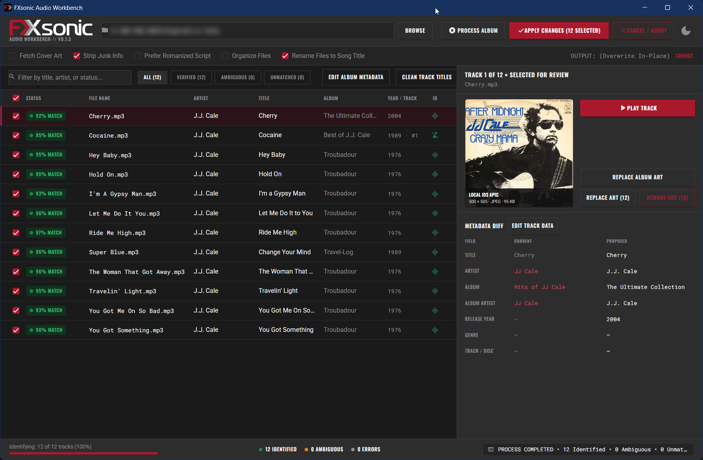
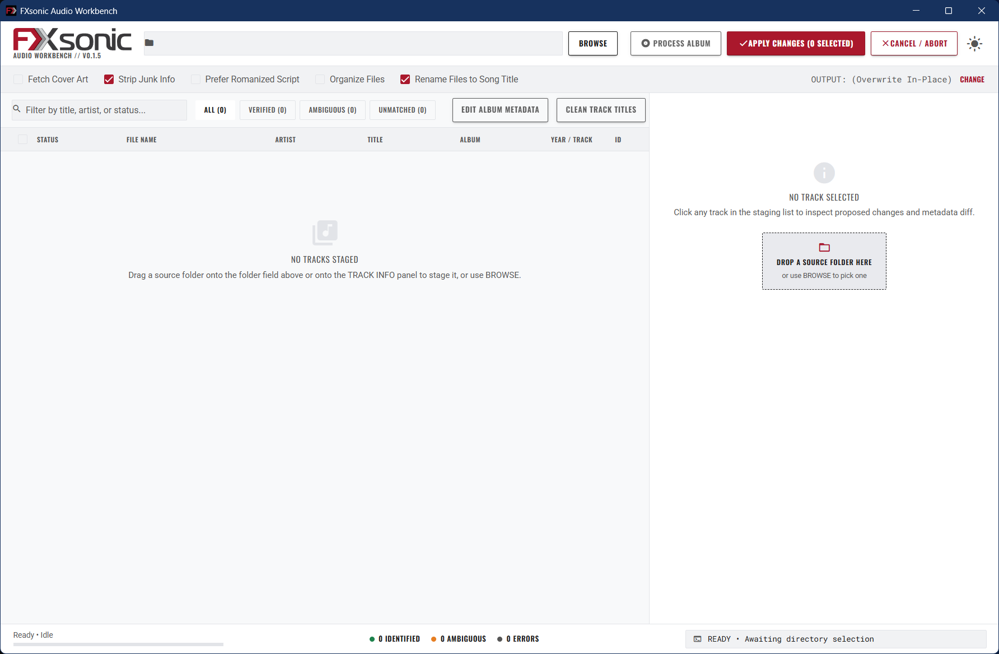

# FXsonic

<p align="center">
  
</p>

FXsonic is a native desktop application for tagging audio files and managing album metadata. It generates acoustic fingerprints with Chromaprint to match recordings against the AcoustID and MusicBrainz databases, writes standard ID3v2.4 tags, and embeds cover art.

---

## Interface

### Dark theme


### Light theme


---

## Features

- Acoustic fingerprinting with bundled `fpcalc` binary
- Automatic track matching through AcoustID and MusicBrainz
- ID3v2.4 tag writing with UTF-8 encoding via `mutagen`
- Cover art retrieval from the Cover Art Archive with automated resizing
- Smart title casing with track number stripping and cleanup of common release noise
- Optional file renaming to match clean track titles
- Native desktop interface built with NiceGUI and PyWebView
- Dark and light theme toggle

---

## Requirements

- Windows 10 or 11
- Python 3.13 or newer (for running from source)
- `fpcalc` (Chromaprint binary, bundled under `bin/fpcalc.exe`)
- Microsoft Edge WebView2 (standard on modern Windows installations)

---

## Quick start

### Running from source with uv

```bash
git clone https://github.com/FXcodez/FXsonic.git
cd FXsonic
uv sync
uv run python main.py
```

### Running with standard pip

```bash
git clone https://github.com/FXcodez/FXsonic.git
cd FXsonic
python -m venv .venv
.venv\Scripts\activate
pip install -e .
python main.py
```

---

## How to use

1. Drop `.mp3` files or folders into the drop zone.
2. FXsonic calculates an acoustic fingerprint for each track and queries MusicBrainz for release data.
3. Review the matched artist, album, track title, and cover art in the staging table and inspector panel.
4. Set options in the bottom bar, including artwork embedding, junk frame stripping, and atomic file renaming.
5. Click **Write Tags** to update your files.

---

## Building a standalone executable

To compile the application into a portable Windows executable:

```bash
uv run python build.py
```

The output is written to `dist/FXsonic/`. The folder contains `FXsonic.exe` and the bundled `bin/fpcalc.exe` binary.

### Packaging a Windows Installer

To bundle the compiled application into a self-contained setup installer (`FXsonic-v0.1.5-Setup.exe`):

```bash
iscc installer.iss
```

---

## Releases

Pre-built packages are published under [Releases](https://github.com/FXcodez/FXsonic/releases):

- **Windows Installer (`FXsonic-v0.1.5-Setup.exe`)**: Recommended for most users. Guided setup wizard with Start Menu integration and a clean uninstaller.
- **Portable Zip (`FXsonic-v0.1.5-windows-x64.zip`)**: Standalone archive. Download, extract, and run `FXsonic.exe` directly without installation or administrator rights.

---

## License

This project is licensed under the [MIT License](LICENSE).
